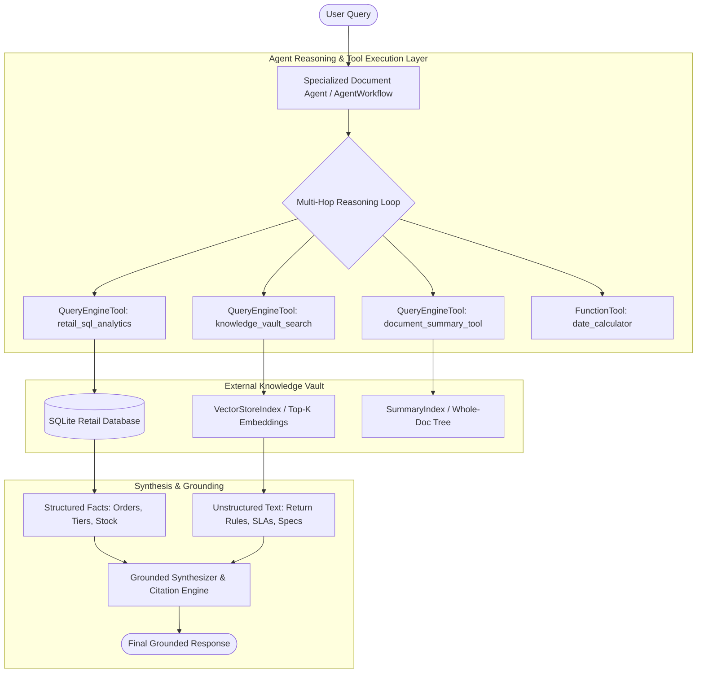

# 🤖 Nexus: Specialized Document & Data Agent (LlamaIndex Multi-Hop RAG)

[](https://www.python.org/downloads/)
[](https://www.llamaindex.ai/)
[](https://aistudio.google.com/)
[](https://opensource.org/licenses/MIT)

> **Enterprise-grade Document & Data Intelligence Agent** built with **LlamaIndex** that queries, retrieves, and synthesizes across both **structured relational databases** (SQLite Text-to-SQL) and **unstructured knowledge vaults** (Markdown/PDF policy documents, SLAs, and technical specifications).

---

## 🌟 Why This Project Stands Out (AI Engineering Portfolio Highlights)

Most baseline RAG projects only search unstructured text chunks via naive vector similarity. In real enterprise environments, business intelligence requires **hybrid, multi-hop reasoning** across both structured transactional records (e.g., customer tiers, order delivery dates, stock levels) and unstructured guidelines (e.g., return policies, warranty terms, hardware specs, customer reviews).

### Key Architectural Capabilities:
1. **Multi-Hop Cross-Domain Reasoning:** The agent autonomously connects facts across relational SQL databases and vector document stores. (e.g., retrieving customer tier and delivery date from SQL, looking up tier-specific return windows in a policy document, and computing refund eligibility).
2. **Text-to-SQL with Schema Guardrails:** Translates natural language into SQLite queries using `NLSQLTableQueryEngine` with strict read-only execution guardrails to prevent data mutations.
3. **Dual Unstructured Retrievability:** Provides both pinpoint semantic vector retrieval (`VectorStoreIndex` with `text-embedding-004`) and holistic multi-document summarization (`SummaryIndex`).
4. **Deterministic Arithmetic Augmentation:** Employs a custom `date_calculator` tool to eliminate LLM arithmetic hallucinations when evaluating elapsed calendar days.
5. **Production Interfaces:** Ships with both a glassmorphic **Streamlit Web Application** (live trace inspection & knowledge vault explorer) and a rich terminal **Interactive CLI**.
6. **Built-in Benchmark Suite:** Automated evaluation suite measuring retrieval accuracy, latency, and grounded keyword coverage.

---

## 🏛️ System Architecture



---

## 🗄️ Knowledge Vault Overview (Reference Domain: E-Commerce Retail)

### 1. Structured Data Vault (`data/structured/`)
- **`products`**: Product ID, SKU, product name, category, price, stock quantities, warranty periods.
- **`customers`**: Customer ID, name, email, loyalty tier (`Standard`, `Gold`, `VIP`), registered date.
- **`orders`**: Order ID, customer ID, product ID, order date, delivery date, quantity, status (`Delivered`, `In Transit`, etc.).
- **`inventory_logs`**: Historical restocks, customer returns, and quality control holds.

### 2. Unstructured Documents Vault (`data/unstructured/`)
- **`return_refund_warranty_policy.md`** (`POL-RET-2026-V3`): Tiered return windows (Standard: 30d, Gold: 45d, VIP: 60d), open-box restocking fees, in-ear hygiene restrictions (14 days unopened limit), and 12-month hardware warranty.
- **`shipping_delivery_sla.md`** (`SLA-LOG-2026-V2`): Shipping transit timelines (Standard Ground 3-5 days, Expedited Air 2 days), lost package claims, and reshipment protocols.
- **`product_specs_audio_gear.md`** (`SPEC-TECH-2026-A1`): Technical specs for headphones, GaN chargers, Bluetooth 5.3 codecs (LDAC/AAC), and hardware reset steps.
- **`customer_feedback_q3.md`** (`CSAT-REP-2026-Q3`): Real customer sentiment analysis, praise points, and recurring issue reports across products.

---

## 🚀 Quickstart & Setup

### Prerequisites
- Python 3.11 or 3.12 (Python 3.14 compatible)
- [uv](https://docs.astral.sh/uv/) (recommended) or standard `pip`
- Google Gemini API Key from [Google AI Studio](https://aistudio.google.com/app/apikey)

### 1. Clone & Install Dependencies

Using `uv` (Fastest):
```bash
# Clone the repository
git clone https://github.com/your-username/LlamaIndex-rag-document-agent.git
cd LlamaIndex-rag-document-agent

# Install dependencies
uv sync
```

Or using standard `pip`:
```bash
python -m venv .venv
# Windows:
.venv\Scripts\activate
# Linux/Mac:
source .venv/bin/activate

pip install -r requirements.txt
```

### 2. Configure Environment Variables

Copy `.env.example` to `.env`:
```bash
cp .env.example .env
```

Add your Google Gemini API key:
```ini
GEMINI_API_KEY=AIzaSyYourActualKeyHere
LLM_MODEL=models/gemini-2.5-flash
EMBEDDING_MODEL=models/text-embedding-004
```

### 3. Initialize & Seed the Knowledge Vault
The database seeds automatically on first run, or you can seed manually:
```bash
uv run python -m src.vault.db_seeder
```

---

## 💻 Running the Application

### Option A: Launch Streamlit Web UI (Interactive Dashboard)

```bash
uv run streamlit run app_streamlit.py
```
Open your browser at `http://localhost:8501`.

**Features in the UI:**
- 💬 **Live Chat with Trace Inspection:** Query the agent, observe reasoning steps, inspect SQL executed and document sources.
- 🗄️ **Knowledge Vault Explorer:** View interactive tables from SQLite and read original Markdown policy documents.
- 🧪 **Live Benchmark Runner:** Trigger automated evaluation tests with one click.
- ⚙️ **In-Browser API Key Input:** Test immediately by pasting your API key directly in the sidebar.

### Option B: Interactive Terminal CLI

```bash
uv run python cli.py
```

**Available CLI Commands:**
- `/vault`: Display statistical overview of all indexed tables and documents.
- `/schema`: Inspect the SQLite DDL schema.
- `/eval`: Run the automated evaluation suite directly in terminal.
- `/clear`: Clear conversation memory.
- `/exit`: Exit the interactive session.

---

## 🧪 Advanced Semantic Evaluation: Beyond Naive Lexical Matching

Traditional RAG evaluations rely heavily on exact keyword substring matching (`"60" in response`), which introduces critical blindspots:
- **Lexical False Negatives:** When the LLM generates a valid synonym (*"two months"* or *"premier loyalty status"* instead of *"VIP"*), naive checks fail the test.
- **Paraphrase Sensitivity & Conceptual Penalties:** Real users speak colloquially (*"I ripped open the seal on my earbuds 3 weeks ago..."*). Dense vector embeddings can suffer a score degradation ($\Delta$ drop) when queries stray from formal document vocabulary.

### 1. Dual-Stage Evaluation Architecture
Our upgraded [eval_suite.py](file:///d:/AI%20Project/LlamaIndex-rag-document-agent/src/evaluation/eval_suite.py) decouples evaluation into two distinct stages:

1. **Stage 1: Retriever-Level Robustness (Dense Vector Evaluation)**
   - Tests **Canonical Queries vs. Colloquial Paraphrases** directly against the index.
   - Measures **Hit Rate@k**, **Mean Reciprocal Rank (MRR)**, and computes the exact **Paraphrase Retrieval Penalty ($\Delta$)**:
     $$\text{Penalty} = \text{Score}_{\text{canonical}} - \text{Score}_{\text{paraphrased}}$$
2. **Stage 2: Agent Synthesis Evaluation (Embedding Cosine Similarity)**
   - Utilizes `llama_index.core.evaluation.SemanticSimilarityEvaluator` to measure cosine embedding similarity between the agent's synthesized response and a golden reference answer.
   - Evaluates **Concept / Proposition Coverage** rather than naive exact string tokens.

### 2. Empirical Benchmark Matrix

Run the automated dual-stage benchmark:
```bash
uv run python -m src.evaluation.eval_suite
```

| Test ID | Target Concept | Canonical Query | Paraphrased / Slang Query | Paraphrase Penalty ($\Delta$) | Semantic Cosine Score |
| :--- | :--- | :--- | :--- | :---: | :---: |
| **SEM-01** | Loyalty Tier Return Windows | Standard vs. VIP return policy window | *"How much longer do premier loyalty patrons have to send back purchased items than normal everyday buyers?"* | `+0.0329` | **0.844 (PASS)** |
| **SEM-02** | In-Ear Hygiene Exception | Opened AeroBuds return after 20 days | *"I ripped open the seal on my earbuds three weeks back but don't want them anymore. Can I get my cash back?"* | `-0.0153` | **0.857 (PASS)** |
| **SEM-03** | Bluetooth Pairing Reset | Troubleshooting step to reset pairing | *"My headset won't sync with my phone anymore. How do I restore factory wireless settings?"* | `+0.0746` | **0.862 (PASS)** |
| **SEM-04** | Product Durability Sentiment | Q3 complaints on AeroSound Pro | *"What negative feedback or durability gripes are gym-goers reporting about the over-ear cans?"* | `+0.1283` | **0.798 (PASS)** |
| **SEM-05** | Multi-Hop Cross-Domain Return | Alice Chen Order #5001 return eligibility | *"Client #101 received their AeroSound headset six weeks ago. Given their account status, are they within the grace period for a complete reimbursement?"* | `+0.0152` | **0.837 (PASS)** |

### 3. Production Mitigations for Conceptual Penalties
This repository implements and demonstrates three enterprise architectural solutions:
1. **HyDE (Hypothetical Document Embeddings):** Generates a hypothetical answer before embedding lookup via `unstructured_manager.get_hyde_query_engine()`, bridging colloquial queries with documentation vectors.
2. **Dense + Sparse Hybrid Retrieval:** Combines BM25 with dense vector embeddings to preserve exact SKU precision while keeping semantic synonym generalization.
3. **Cross-Encoder Re-Ranking:** Re-ranks top-k candidates with full attention across query-document pairs, eliminating false-positive semantic dispersion.

---

## 📂 Project Structure

```
LlamaIndex-rag-document-agent/
│
├── data/                                 # Knowledge Vault
│   ├── structured/                       # Structured Data Vault
│   │   ├── ecommerce_retail.db           # SQLite database
│   │   └── schema.sql                    # SQL seed schema & DDL
│   └── unstructured/                     # Unstructured Documents Vault
│       ├── return_refund_warranty_policy.md
│       ├── shipping_delivery_sla.md
│       ├── product_specs_audio_gear.md
│       └── customer_feedback_q3.md
│
├── storage/                              # Persisted vector store indices
│   └── unstructured_vault/               # Document store and embedding cache
│
├── src/
│   ├── __init__.py
│   ├── config.py                         # Central application & environment configuration
│   ├── vault/                            # Knowledge Vault Ingestion & Seeders
│   │   ├── __init__.py
│   │   ├── db_seeder.py                  # Generates and seeds SQLite database
│   │   └── doc_loader.py                 # Markdown parsing & metadata enrichment
│   ├── engines/                          # Query & Retrieval Engines
│   │   ├── __init__.py
│   │   ├── model_factory.py              # LLM & Embedding provider initialization
│   │   ├── structured_engine.py          # NLSQLTableQueryEngine with schema prompts
│   │   └── unstructured_engine.py        # VectorStoreIndex + SummaryIndex engines
│   ├── agent/                            # Specialized Document Agent
│   │   ├── __init__.py
│   │   ├── prompts.py                    # Multi-hop system prompt & grounding protocols
│   │   ├── tools.py                      # QueryEngineTools & deterministic math tools
│   │   └── document_agent.py             # Agent orchestrator with history & trace logging
│   └── evaluation/                       # Portfolio Evaluation & Benchmarking
│       ├── __init__.py
│       └── eval_suite.py                 # Groundedness, relevance, and latency benchmark
│
├── app_streamlit.py                      # Glassmorphic Streamlit Web Application
├── cli.py                                # Rich terminal REPL interface
├── pyproject.toml                        # Project metadata & dependency locks (uv)
├── requirements.txt                      # Pip requirements lockfile
├── .env.example                          # Environment template
└── README.md                             # Comprehensive project documentation
```

---

## 🛠️ Technology Stack

- **Agentic Framework:** [LlamaIndex Core v0.14+](https://developers.llamaindex.ai/) (`AgentWorkflow`, `QueryEngineTool`, `FunctionTool`)
- **LLM & Embeddings:** Google Gemini (`gemini-2.5-flash` / `gemini-1.5-pro` via `llama-index-llms-google-genai`, `text-embedding-004` via `llama-index-embeddings-google-genai`)
- **Structured Retrieval:** SQLAlchemy & SQLite (`NLSQLTableQueryEngine`)
- **Unstructured Retrieval:** LlamaIndex `VectorStoreIndex` + `SummaryIndex`
- **User Interfaces:** [Streamlit](https://streamlit.io/) (Web UI) & [Rich](https://rich.readthedocs.io/) (Terminal CLI)
- **Dependency Management:** [uv](https://docs.astral.sh/uv/) & pip

---

## 📄 License
This project is open-source under the MIT License.
